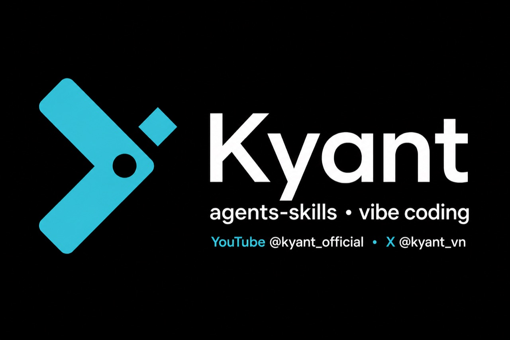
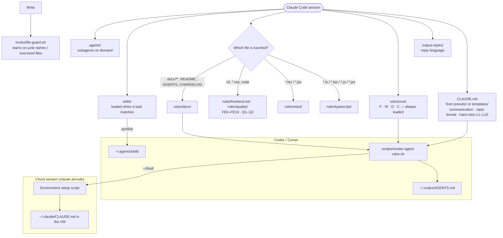
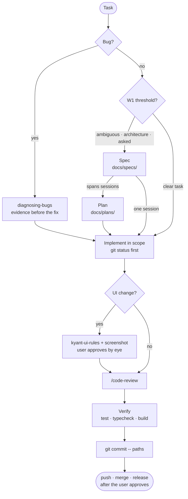

<p align="center">
  
</p>

How rules load in a session:



How a task moves through the workflow:



<p align="center">
  <a href="README.md">Tiếng Việt</a> ·
  <strong>English</strong>
</p>

<h1 align="center">agents-skills</h1>

<p align="center">
  <strong>Kyant</strong> toolkit — custom agents, skills, rules &amp; vibe-coding presets for
  <a href="https://claude.com/claude-code">Claude Code</a> and
  <a href="https://github.com/openai/codex">Codex</a>, built from daily livestream use.
</p>

<p align="center">
  <a href="https://www.youtube.com/@kyant_official"></a>
  <a href="https://x.com/kyant_vn"></a>
  <a href="#quick-start"></a>
  <a href="https://claude.com/claude-code"></a>
  <a href="https://github.com/openai/codex"></a>
</p>

<p align="center">
  <a href="#quick-start">Quick start</a> ·
  <a href="#usage">CLI install</a> ·
  <a href="#agents">Agents</a> ·
  <a href="#skills">Skills</a> ·
  <a href="#claudemd-presets-vibe-coding">Presets</a>
</p>

---

Part of the **Kyant** channel system (live vibe coding). No sessions, memory, or secrets are published (see [`.gitignore`](.gitignore)).

## Quick start

```bash
npx github:mxrsv/agents-skills install
```

Common one-liners:

```bash
npx github:mxrsv/agents-skills install --all
npx github:mxrsv/agents-skills install --preset kyant-vibe
npx github:mxrsv/agents-skills install --skill brainstorm --agent planner
npx github:mxrsv/agents-skills list
```

## Usage

### CLI install (recommended)

No clone needed:

```bash
npx github:mxrsv/agents-skills
npx github:mxrsv/agents-skills install
```

Interactive flow:

1. Choose what to install — everything, skills/agents/rules, a **CLAUDE.md preset**, or pick items (`1 3 5`, `1-4`, or `a`)
2. Platform — **Claude Code**, **Codex**, or **both**
3. Target — global (`~/.claude` / `~/.codex`) or local (`./.claude` / `./.codex`)
4. Skip or overwrite existing files
5. Confirm

```
════════════════════════════════════════
 agents-skills installer
════════════════════════════════════════
   1) Everything (skills + agents + commands + rules)
   2) All skills
   3) All agents
   4) All commands
   5) All rules
   6) CLAUDE.md preset…
   7) Pick specific skills…
   …

════════════════════════════════════════
 Platform
════════════════════════════════════════
   1) Claude Code  (~/.claude)
   2) Codex        (~/.codex)
   3) Both
```

Codex notes:

- Slash-commands install into `prompts/` (not `commands/`).
- Agents are skipped on Codex; skills, commands, and rules still install.

Non-interactive:

```bash
npx github:mxrsv/agents-skills install --all
npx github:mxrsv/agents-skills install --skills
npx github:mxrsv/agents-skills install --skill brainstorm --agent planner
npx github:mxrsv/agents-skills install --local --all
npx github:mxrsv/agents-skills install --codex --skills --commands
npx github:mxrsv/agents-skills install --both --skill brainstorm
npx github:mxrsv/agents-skills install --preset kyant-vibe
npx github:mxrsv/agents-skills list
npx github:mxrsv/agents-skills list presets
```

Clone once (no `npx` re-fetch):

```bash
git clone https://github.com/mxrsv/agents-skills.git
cd agents-skills
./bin/agents-skills install
```

### Manual copy

```bash
git clone https://github.com/mxrsv/agents-skills.git
cp -r agents-skills/agents   ~/.claude/agents
cp -r agents-skills/skills   ~/.claude/skills
cp -r agents-skills/commands ~/.claude/commands
cp -r agents-skills/rules    ~/.claude/rules
```

Claude Code discovers agents (`Agent` tool) and skills (`Skill` tool) from each file’s frontmatter `description` — no extra config.

## Structure

| Path                       | Role                                                    |
| -------------------------- | ------------------------------------------------------- |
| [`agents/`](agents/)       | Specialized subagents (review, planning, research…)     |
| [`skills/`](skills/)       | Skills — source of truth; symlinked into `~/.agents/skills` for Codex / Cursor |
| [`rules/`](rules/)         | Always-loaded + path-scoped rules                       |
| [`templates/`](templates/) | `AGENTS.md` / `CLAUDE.md` starters + project structures |
| [`presets/`](presets/)     | Named `CLAUDE.md` presets (live vibe-coding)            |
| [`hooks/`](hooks/)         | File-guard (junk names, oversized files)                |
| [`assets/`](assets/)       | README media                                            |

## Agents

Claude Code discovers these via the `Agent` tool (frontmatter `description`). Codex has no per-file subagent mechanism — agents are skipped on the Codex target.

### Planning & architecture

| Agent                                      | Description                                                                              |
| ------------------------------------------ | ---------------------------------------------------------------------------------------- |
| [`analyst`](agents/analyst.md)             | Research, market/competitive analysis, brainstorming facilitation; returns drafts as text for review |
| [`Explore`](agents/explore.md)             | Overrides built-in Explore: read-only codebase search on Haiku (`effort: high`) to cut cost |
| [`architect`](agents/architect.md)         | System architecture and technical decisions for large features/refactors                 |
| [`planner`](agents/planner.md)             | Detailed planning for complex features and refactors                                     |

### Code review & reliability

| Agent                                                      | Description                                                               |
| ---------------------------------------------------------- | ------------------------------------------------------------------------- |
| [`typescript-reviewer`](agents/typescript-reviewer.md)     | Deep TypeScript/JS: types, async correctness, security                    |
| [`react-reviewer`](agents/react-reviewer.md)               | Deep React/JSX: hooks, render performance, a11y                           |
| [`database-reviewer`](agents/database-reviewer.md)         | PostgreSQL: query optimization, schema, Supabase practices                |
| [`security-reviewer`](agents/security-reviewer.md)         | OWASP Top 10, secrets, injection, SSRF                                    |
| [`silent-failure-hunter`](agents/silent-failure-hunter.md) | Swallowed errors, bad fallbacks, missing error propagation                |
| [`swift-reviewer`](agents/swift-reviewer.md)               | Deep Swift: concurrency, ARC, value semantics, protocols |
| [`go-reviewer`](agents/go-reviewer.md)                     | Deep Go: error handling, goroutines, idioms |
| [`rust-reviewer`](agents/rust-reviewer.md)                 | Deep Rust: ownership, lifetimes, `unsafe`, error handling |
| [`pr-test-analyzer`](agents/pr-test-analyzer.md)           | Grades the tests of a change: behaviour covered, real bugs caught |

### Performance & maintenance

| Agent                                                      | Description                                                |
| ---------------------------------------------------------- | ---------------------------------------------------------- |
| [`performance-optimizer`](agents/performance-optimizer.md) | Finds bottlenecks: bundle, render, memory leaks, algorithms |
| [`refactor-cleaner`](agents/refactor-cleaner.md)           | Removes dead and duplicate code with `knip` / `depcheck` / `ts-prune`, tests after each batch |
| [`doc-updater`](agents/doc-updater.md)                     | Keeps living docs (`README`, `CHANGELOG`, `docs/`) in line with code |

## Skills

### Discovery & planning

Under the [documentation rules](rules/core/docs.md), the conversation supplies goals and approvals. Specs in `docs/specs/YYYY-MM-DD-<slug>.md` own requirements and acceptance criteria; the [planning skill](skills/planning/SKILL.md) keeps technical approach, tasks, verification and handoff in `docs/plans/YYYY-MM-DD-<slug>.md`, linking to the spec instead of copying requirements. No issue key or external tracker is required. Specs and plans whose full scope is accepted remain as historical records; durable knowledge belongs in living docs. Small, clear tasks require neither a spec nor a plan.

| Skill                                                                               | Description                                                  |
| ----------------------------------------------------------------------------------- | ------------------------------------------------------------ |
| [`brainstorm`](skills/brainstorm/SKILL.md)                                          | Before building — clarify, compare approaches, lock the spec |
| [`planning`](skills/planning/SKILL.md) | Execution plan once scope is clear                           |
| [`codebase-onboarding`](skills/codebase-onboarding/SKILL.md)                        | Fast architecture map for unfamiliar repos                   |
| [`interview-me`](skills/interview-me/SKILL.md)                                      | One-question-at-a-time interview to extract real intent      |
| [`kyant-intent`](skills/kyant-intent/SKILL.md)                                      | `interview-me` in its own frame: Read→Ask→Dig→Stop→Lock      |
| [`kyant-grill`](skills/kyant-grill/SKILL.md)                                        | `grilling` made quick: intent first, answers via a dialog    |
| [`find-skills`](skills/find-skills/SKILL.md)                                        | Discover / install agent skills                              |
| [`explain`](skills/explain/SKILL.md)                                                | Teach a concept, bug, or design decision in a chosen style   |

### Review, testing & verification

| Skill                                                                | Description                                       |
| -------------------------------------------------------------------- | ------------------------------------------------- |
| [`review`](skills/review/SKILL.md)                                   | Findings-first review of specs, plans, or code    |
| [`security-review`](skills/security-review/SKILL.md)                 | Auth, input, secrets, payments                    |
| [`docs-drift`](skills/docs-drift/SKILL.md)                           | Docs vs real code behavior (read-only by default) |
| [`diagnosing-bugs`](skills/diagnosing-bugs/SKILL.md)                 | Hard bugs and performance regressions             |
| [`production-audit`](skills/production-audit/SKILL.md) | Score production readiness 0–100 from local evidence: auth, data, webhooks, ops, UX |

### Frontend & prototyping

| Skill                                                                      | Description                                    |
| -------------------------------------------------------------------------- | ---------------------------------------------- |
| [`frontend-design-audit`](skills/frontend-design-audit/SKILL.md)           | Off          |
| [`prototype`](skills/prototype/SKILL.md)                                   | Throwaway prototype before committing          |
| [`kyant-ui-rules`](skills/kyant-ui-rules/SKILL.md) | Owner's UI rulebook, read before any UI mock, build or review |
| [`liquid-glass-design`](skills/liquid-glass-design/SKILL.md) | iOS 26 Liquid Glass: SwiftUI, UIKit, WidgetKit |
| [`design-system`](skills/design-system/SKILL.md) | Extract tokens into `DESIGN.md` + preview, score UI on 10 dimensions, flag AI slop |
| [`make-interfaces-feel-better`](skills/make-interfaces-feel-better/SKILL.md) | Polish details: concentric radius, optical alignment, `tabular-nums`, transitions, hit areas |
| [`quality-gates`](skills/quality-gates/SKILL.md)                           | UI + code quality gates: study, probe, lint gates, primitives, state sheets, UI review |
| [`shadcn`](skills/shadcn/SKILL.md)                                         | shadcn/ui components, registries, chat UI      |

### Content, docs & workflow

| Skill                                                                  | Description                                               |
| ---------------------------------------------------------------------- | --------------------------------------------------------- |
| [`hand-off`](skills/hand-off/SKILL.md)                                 | Compact the conversation for another agent                |
| [`context-budget`](skills/context-budget/SKILL.md)                     | Audit token use across agents, skills, MCP, `CLAUDE.md`   |
| [`article-writing`](skills/article-writing/SKILL.md) | Long-form articles (blog, guide, newsletter) in a supplied voice, no AI filler |
| [`deployment-patterns`](skills/deployment-patterns/SKILL.md) | Deploy strategies, multi-stage Docker, CI/CD, health checks, rollback, production checklist |

### Sharing with Codex / Cursor

Self-authored skills under `skills/` are the **source of truth** (git-tracked). [`scripts/sync-agents-skills.sh`](scripts/sync-agents-skills.sh) creates `~/.agents/skills/<x> → ~/.claude/skills/<x>` symlinks for every git-tracked skill; Codex reads `~/.agents/skills` natively and follows symlinks, so Claude Code, Codex and Cursor all use the same copy — no more drifting duplicates. Codex invokes a skill as `$name` instead of `/name`. Run with `--check` to detect drift: missing symlinks, frontmatter keys no harness reads, same-name copies in `~/.codex/skills`.

### Cloud sessions (claude.ai/code, routines)

Cloud sessions don't read your local `~/.claude`. [`scripts/render-agent-rules.sh`](scripts/render-agent-rules.sh) `--cloud | pbcopy` prints a self-contained setup script: it writes `~/.claude/CLAUDE.md` in the VM (the same bundle as Codex plus [`templates/cloud-extra.md`](templates/cloud-extra.md)) and the templates / rules the bundle points to by path. Paste it into the environment's **Setup script** field (append to any existing script, don't replace it), then run `/context` in a fresh cloud session and look for `/root/.claude/CLAUDE.md` under Memory files. The environment is cached for about 7 days; after changing the rules, render and paste again — the hash line changes with the content, so the cache rebuilds. Local skills don't reach the cloud; enable the ones you need on your claude.ai account.

### Shared external skills

Installed under `~/.agents/skills` and symlinked into Claude Code / Codex. The CLI skips broken symlinks by default; use `--with-symlinks` when targets exist.

| Skill                                                            | Upstream                                                                                        |
| ---------------------------------------------------------------- | ----------------------------------------------------------------------------------------------- |
| [`frontend-design-audit`](skills/frontend-design-audit/SKILL.md) | [mistyhx/frontend-design-audit](https://github.com/mistyhx/frontend-design-audit)               |
| [`liquid-glass-design`](skills/liquid-glass-design/SKILL.md) | [affaan-m/ecc](https://github.com/affaan-m/ecc) |
| [`article-writing`](skills/article-writing/SKILL.md) | [affaan-m/ecc](https://github.com/affaan-m/ecc) |
| [`design-system`](skills/design-system/SKILL.md) | [affaan-m/ecc](https://github.com/affaan-m/ecc) |
| [`deployment-patterns`](skills/deployment-patterns/SKILL.md) | [affaan-m/ecc](https://github.com/affaan-m/ecc) |
| [`production-audit`](skills/production-audit/SKILL.md) | [affaan-m/ecc](https://github.com/affaan-m/ecc) |
| [`make-interfaces-feel-better`](skills/make-interfaces-feel-better/SKILL.md) | [affaan-m/ecc](https://github.com/affaan-m/ecc) |
| [`diagnosing-bugs`](skills/diagnosing-bugs/SKILL.md)             | [mattpocock/skills](https://github.com/mattpocock/skills)                                       |
| [`shadcn`](skills/shadcn/SKILL.md)                               | [shadcn-ui/ui](https://github.com/shadcn-ui/ui)                                                 |
| [`ponytail-review`](skills/ponytail-review/SKILL.md)             | [DietrichGebert/ponytail](https://github.com/DietrichGebert/ponytail)                           |
| [`ponytail-audit`](skills/ponytail-audit/SKILL.md)               | [DietrichGebert/ponytail](https://github.com/DietrichGebert/ponytail)                           |
| [`ponytail-debt`](skills/ponytail-debt/SKILL.md)                 | [DietrichGebert/ponytail](https://github.com/DietrichGebert/ponytail)                           |
| [`caveman`](skills/caveman/SKILL.md)                             | [JuliusBrussee/caveman](https://github.com/JuliusBrussee/caveman)                               |
| [`ultracave`](skills/ultracave/SKILL.md)                         | [JuliusBrussee/caveman](https://github.com/JuliusBrussee/caveman)                               |
| [`megacave`](skills/megacave/SKILL.md)                           | [JuliusBrussee/caveman](https://github.com/JuliusBrussee/caveman)                               |
| [`interview-me`](skills/interview-me/SKILL.md)                   | [addyosmani/agent-skills](https://github.com/addyosmani/agent-skills) (MIT, © 2025 Addy Osmani) |
| [`kyant-intent`](skills/kyant-intent/SKILL.md)                   | [addyosmani/agent-skills](https://github.com/addyosmani/agent-skills) (MIT, © 2025 Addy Osmani) |

## CLAUDE.md presets (vibe coding)

**Kyant** livestream preset + a neutral template you can fork.

| Path                                                           | What it is                                                                                |
| -------------------------------------------------------------- | ----------------------------------------------------------------------------------------- |
| [`templates/CLAUDE.template.md`](templates/CLAUDE.template.md) | Neutral global `CLAUDE.md` — fill `{{placeholders}}`                                      |
| [`presets/kyant-vibe/`](presets/kyant-vibe/)                   | **Kyant** vibe-coding preset (Vietnamese tone, short answers, frontend gates, hard rules) |

```bash
npx github:mxrsv/agents-skills install --preset kyant-vibe
cp templates/CLAUDE.template.md ~/.claude/CLAUDE.md   # or start from template
```

Presets write `CLAUDE.md` at the install target. Pair with [`rules/`](rules/) so hard-rule links resolve. Fork the preset — language and emoji policy are taste, not law.

## Rules & templates

| Path                                                               | What                                                                                     |
| ------------------------------------------------------------------ | ---------------------------------------------------------------------------------------- |
| [`rules/core/`](rules/core/)                                       | Always-loaded: file creation (F), workflow (W), docs (D), coding style (C) |
| [`rules/typescript/`](rules/typescript/)                           | Path-scoped for `*.ts/tsx/js/jsx`                                                        |
| [`rules/react/`](rules/react/)                                     | Path-scoped for `*.tsx/jsx`                                                              |
| [`rules/quality/`](rules/quality/)                                 | Path-scoped: code (Q1–Q2); UI rules in [`rules/frontend.md`](rules/frontend.md) (always loaded) + skill `kyant-ui-rules`; gates in skill `quality-gates`            |
| [`templates/AGENTS.template.md`](templates/AGENTS.template.md)     | Per-project delta rules skeleton                                                         |
| [`templates/CLAUDE.template.md`](templates/CLAUDE.template.md)     | Neutral `CLAUDE.md` starter                                                              |
| [`templates/project-structure.md`](templates/project-structure.md) | Canonical directory trees                                                                |
| [`hooks/file-guard.sh`](hooks/file-guard.sh)                       | Blocks junk filenames; warns on oversized / misplaced files                              |
