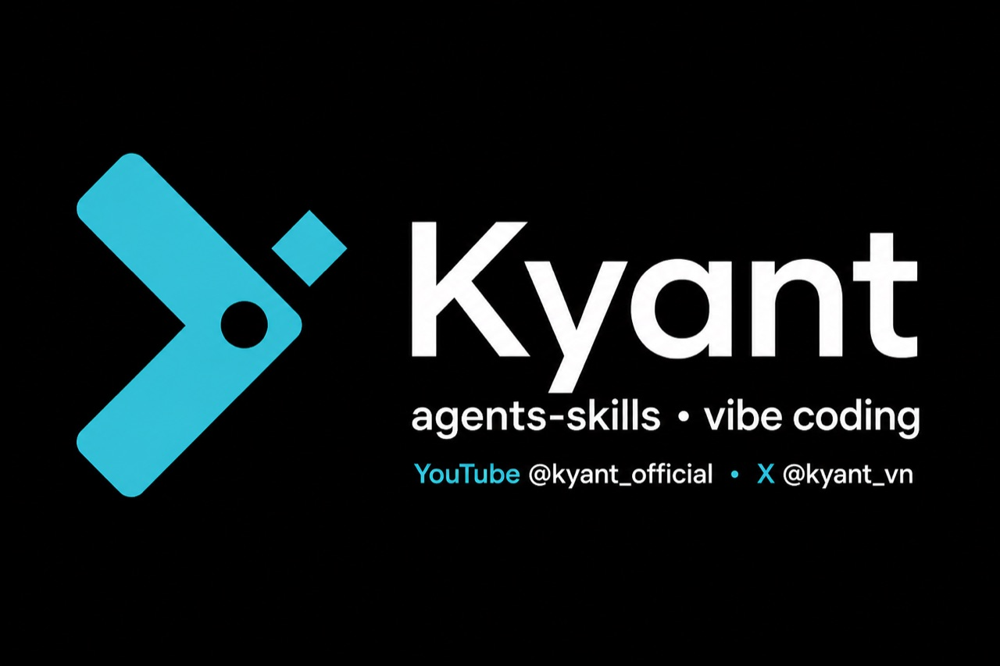
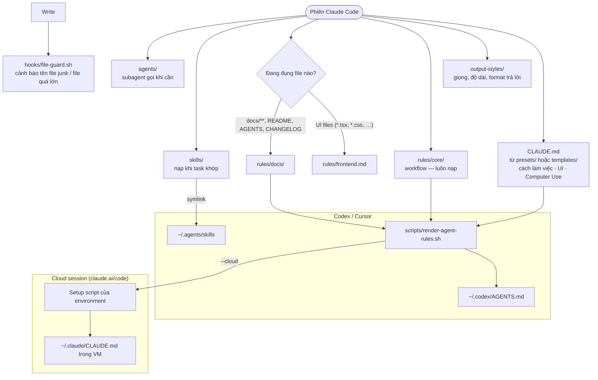
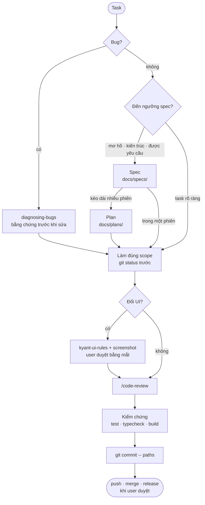

<p align="center">
  
</p>

Luật được nạp thế nào trong một phiên:



Một task đi qua workflow thế nào:



<p align="center">
  <strong>Tiếng Việt</strong> ·
  <a href="README.en.md">English</a>
</p>

<h1 align="center">agents-skills</h1>

<p align="center">
  Bộ toolkit của <strong>Kyant</strong> — custom agents, skills, rules &amp; vibe-coding presets cho
  <a href="https://claude.com/claude-code">Claude Code</a> và
  <a href="https://github.com/openai/codex">Codex</a>, dựng từ lúc livestream hàng ngày.
</p>

<p align="center">
  <a href="https://www.youtube.com/@kyant_official"></a>
  <a href="https://x.com/kyant_vn"></a>
  <a href="#bắt-đầu-nhanh"></a>
  <a href="https://claude.com/claude-code"></a>
  <a href="https://github.com/openai/codex"></a>
</p>

<p align="center">
  <a href="#bắt-đầu-nhanh">Bắt đầu nhanh</a> ·
  <a href="#cách-dùng">Cài bằng CLI</a> ·
  <a href="#agents">Agents</a> ·
  <a href="#skills">Skills</a> ·
  <a href="#claudemd-presets-vibe-coding">Presets</a>
</p>

---

Một phần hệ thống kênh **Kyant** (live vibe coding). Không publish session, memory hay secrets (xem [`.gitignore`](.gitignore)).

## Bắt đầu nhanh

```bash
npx github:mxrsv/agents-skills install
```

Một vài lệnh hay dùng:

```bash
npx github:mxrsv/agents-skills install --all
npx github:mxrsv/agents-skills install --preset kyant-vibe
npx github:mxrsv/agents-skills install --skill brainstorm --agent planner
npx github:mxrsv/agents-skills list
```

## Cách dùng

### Cài bằng CLI (khuyên dùng)

Không cần clone:

```bash
npx github:mxrsv/agents-skills
npx github:mxrsv/agents-skills install
```

Luồng tương tác:

1. Chọn cái cần cài — hết, skills/agents/rules, một **CLAUDE.md preset**, hoặc chọn từng mục (`1 3 5`, `1-4`, hoặc `a`)
2. Platform — **Claude Code**, **Codex**, hoặc **cả hai**
3. Target — global (`~/.claude` / `~/.codex`) hoặc local (`./.claude` / `./.codex`)
4. Bỏ qua hoặc ghi đè file đã có
5. Xác nhận

```
════════════════════════════════════════
 agents-skills installer
════════════════════════════════════════
   1) Everything (skills + agents + commands + rules)
   2) All skills
   3) All agents
   4) All commands
   5) All rules
   6) CLAUDE.md preset…
   7) Pick specific skills…
   …

════════════════════════════════════════
 Platform
════════════════════════════════════════
   1) Claude Code  (~/.claude)
   2) Codex        (~/.codex)
   3) Both
```

Lưu ý với Codex:

- Slash-commands cài vào `prompts/` (không phải `commands/`).
- Agents bị bỏ qua trên Codex; skills, commands và rules vẫn cài bình thường.

Không tương tác:

```bash
npx github:mxrsv/agents-skills install --all
npx github:mxrsv/agents-skills install --skills
npx github:mxrsv/agents-skills install --skill brainstorm --agent planner
npx github:mxrsv/agents-skills install --local --all
npx github:mxrsv/agents-skills install --codex --skills --commands
npx github:mxrsv/agents-skills install --both --skill brainstorm
npx github:mxrsv/agents-skills install --preset kyant-vibe
npx github:mxrsv/agents-skills list
npx github:mxrsv/agents-skills list presets
```

Clone một lần (không phải `npx` fetch lại):

```bash
git clone https://github.com/mxrsv/agents-skills.git
cd agents-skills
./bin/agents-skills install
```

### Copy thủ công

```bash
git clone https://github.com/mxrsv/agents-skills.git
cp -r agents-skills/agents   ~/.claude/agents
cp -r agents-skills/skills   ~/.claude/skills
cp -r agents-skills/commands ~/.claude/commands
cp -r agents-skills/rules    ~/.claude/rules
```

Claude Code tự nhận agents (`Agent` tool) và skills (`Skill` tool) từ frontmatter `description` của từng file — không cần cấu hình thêm.

## Cấu trúc

| Path                       | Vai trò                                              |
| -------------------------- | ---------------------------------------------------- |
| [`agents/`](agents/)       | Subagent chuyên biệt (review, research, docs)        |
| [`skills/`](skills/)       | Skill — nguồn chuẩn; symlink sang `~/.agents/skills` cho Codex / Cursor |
| [`rules/`](rules/)         | Rules luôn nạp + theo path                           |
| [`templates/`](templates/) | Starter `AGENTS.md` / `CLAUDE.md` + cấu trúc project |
| [`presets/`](presets/)     | Preset `CLAUDE.md` có tên (live vibe-coding)         |
| [`hooks/`](hooks/)         | File-guard (tên junk, file quá lớn)                  |
| [`assets/`](assets/)       | Media cho README                                     |

## Agents

Claude Code nhận các agent này qua `Agent` tool (frontmatter `description`). Codex không có cơ chế subagent theo file — agents bị bỏ qua khi cài sang Codex.

### Agent

| Agent | Mô tả |
| :- | :- |
| [`code-reviewer`](agents/code-reviewer.md) | Review diff có xếp hạng CRITICAL / HIGH / MEDIUM / LOW; nạp checklist theo loại file |
| [`read-only-reviewer`](agents/read-only-reviewer.md) | Mắt mới, chỉ đọc: review mock, feature đã build hoặc codebase theo brief |
| [`Explore`](agents/explore.md) | Ghi đè Explore built-in: tìm kiếm codebase chỉ-đọc, chạy Haiku (`effort: high`) cho rẻ |
| [`analyst`](agents/analyst.md) | Nghiên cứu, phân tích thị trường/đối thủ, hỗ trợ brainstorm; trả draft dạng text để người duyệt |
| [`doc-updater`](agents/doc-updater.md) | Đồng bộ docs sống (`README`, `CHANGELOG`, `docs/`) với code |

### Checklist review (skill)

Hai reviewer nạp các skill này qua `skills:` hoặc Skill tool; người dùng không gọi trực tiếp.

| Skill | Mô tả |
| :- | :- |
| [`review-typescript`](skills/review-typescript/SKILL.md) | TypeScript/JS sâu: types, async đúng, security |
| [`review-react`](skills/review-react/SKILL.md) | React/JSX sâu: hooks, hiệu năng render, a11y |
| [`review-database`](skills/review-database/SKILL.md) | PostgreSQL: tối ưu query, schema, thực hành Supabase |
| [`review-security-checklist`](skills/review-security-checklist/SKILL.md) | OWASP Top 10, secrets, injection, SSRF (review code đã viết; lúc đang viết dùng `security-review`) |
| [`review-silent-failures`](skills/review-silent-failures/SKILL.md) | Lỗi bị nuốt, fallback kém, thiếu lan truyền lỗi |
| [`review-swift`](skills/review-swift/SKILL.md) | Swift sâu: concurrency, ARC, value semantics, protocol |
| [`review-go`](skills/review-go/SKILL.md) | Go sâu: xử lý lỗi, goroutine, idiom |
| [`review-rust`](skills/review-rust/SKILL.md) | Rust sâu: ownership, lifetime, `unsafe`, xử lý lỗi |
| [`review-type-design`](skills/review-type-design/SKILL.md) | Chấm type: có chặn được illegal state không (encapsulation, invariant, enforcement) |

## Skills

### Khám phá & lập plan

Theo [quy tắc tài liệu](rules/core/docs.md), bạn giao việc và chốt quyết định trong chat. Spec ở `docs/specs/YYYY-MM-DD-<slug>.md` giữ yêu cầu và tiêu chí nghiệm thu; [skill planning](skills/planning/SKILL.md) viết cách triển khai, checklist, bằng chứng kiểm chứng và bàn giao vào `docs/plans/YYYY-MM-DD-<slug>.md`, liên kết tới spec thay vì chép lại yêu cầu. Không cần issue key hay dịch vụ theo dõi bên ngoài. Khi toàn bộ phạm vi được nghiệm thu, spec và plan được giữ làm lịch sử; kiến thức còn áp dụng được chắt vào tài liệu sống. Việc nhỏ, rõ ràng không bắt buộc có spec hay plan.

| Skill                                                                            | Mô tả                                                          |
| -------------------------------------------------------------------------------- | -------------------------------------------------------------- |
| [`brainstorm`](skills/brainstorm/SKILL.md)                                       | Trước khi build — làm rõ nhu cầu, so hướng làm, chốt spec      |
| [`planning`](skills/planning/SKILL.md)                                           | Plan thực thi khi phạm vi đã rõ                                |
| [`codebase-onboarding`](skills/codebase-onboarding/SKILL.md)                     | Bản đồ kiến trúc nhanh cho repo lạ                             |
| [`research`](skills/research/SKILL.md) | Agent nền tra nguồn gốc (docs, source, spec), ghi kết quả có trích dẫn ra file Markdown |
| [`interview-me`](skills/interview-me/SKILL.md)                                   | Phỏng vấn từng câu để moi ý định thật                          |
| [`kyant-intent`](skills/kyant-intent/SKILL.md)                                   | Khung riêng của `interview-me`: Read → Ask → Dig → Stop → Lock |
| [`kyant-grill`](skills/kyant-grill/SKILL.md)                                     | `grilling` trả lời nhanh: chốt ý định trước, hỏi bằng hộp chọn |
| [`find-skills`](skills/find-skills/SKILL.md)                                     | Tìm / cài agent skills                                         |
| [`explain`](skills/explain/SKILL.md)                                             | Giảng khái niệm, bug, hoặc quyết định thiết kế theo style chọn |

### Review, test & xác minh

| Skill                                                | Mô tả                                              |
| ---------------------------------------------------- | -------------------------------------------------- |
| [`security-review`](skills/security-review/SKILL.md) | Auth, input, secrets, thanh toán                   |
| [`docs-drift`](skills/docs-drift/SKILL.md)           | Docs vs hành vi code thật (mặc định chỉ đọc)       |
| [`diagnosing-bugs`](skills/diagnosing-bugs/SKILL.md) | Bug khó và tụt hiệu năng                           |
| [`click-path-audit`](skills/click-path-audit/SKILL.md) | Lần theo từng nút qua chuỗi state, bắt bug các hàm tự triệt tiêu nhau (nút "không làm gì") |
| [`skill-comply`](skills/skill-comply/SKILL.md)       | Đo agent có thật sự theo một skill/rule không (3 kịch bản, chạy `claude -p`, tốn token) |
| [`production-audit`](skills/production-audit/SKILL.md) | Chấm độ sẵn sàng lên production 0–100 từ bằng chứng local: auth, dữ liệu, webhook, vận hành, UX |

### Frontend & prototype

| Skill                                                            | Mô tả                                         |
| ---------------------------------------------------------------- | --------------------------------------------- |
| [`frontend-design-audit`](skills/frontend-design-audit/SKILL.md) | Tắt        |
| [`prototype`](skills/prototype/SKILL.md)                         | Prototype bỏ được trước khi chốt hướng        |
| [`kyant-ui-rules`](skills/kyant-ui-rules/SKILL.md) | Bộ luật UI của chủ, đọc trước mọi mock/build/review UI |
| [`liquid-glass-design`](skills/liquid-glass-design/SKILL.md) | Liquid Glass iOS 26: SwiftUI, UIKit, WidgetKit |
| [`design-system`](skills/design-system/SKILL.md) | Rút token ra `DESIGN.md` + preview, chấm UI 10 tiêu chí, soi AI slop |
| [`make-interfaces-feel-better`](skills/make-interfaces-feel-better/SKILL.md) | Chi tiết làm UI mượt: radius lồng nhau, căn quang học, `tabular-nums`, transition, hit area |
| [`frontend-design-direction`](skills/frontend-design-direction/SKILL.md) | Chốt hướng thiết kế + contract trước khi code UI, gate render với `check-evidence.js` |
| [`quality-gates`](skills/quality-gates/SKILL.md)                 | Gate chất lượng UI + code: study, probe, cài lint gate, primitive, sheet trạng thái, review UI |
| [`shadcn`](skills/shadcn/SKILL.md)                               | Component shadcn/ui, registry, chat UI        |

### Nội dung, docs & quy trình

| Skill                                              | Mô tả                                         |
| -------------------------------------------------- | --------------------------------------------- |
| [`hand-off`](skills/hand-off/SKILL.md)             | Nén hội thoại để agent khác nhận việc         |
| [`context-budget`](skills/context-budget/SKILL.md) | Rà token qua agents, skills, MCP, `CLAUDE.md` |
| [`run-agents`](skills/run-agents/SKILL.md)         | Giao việc cho subagent, build một mạch plan   |
| [`article-writing`](skills/article-writing/SKILL.md) | Viết bài dài (blog, guide, newsletter) theo giọng mẫu, cấm văn AI sáo rỗng |
| [`deployment-patterns`](skills/deployment-patterns/SKILL.md) | Chiến lược deploy, Docker multi-stage, CI/CD, health check, rollback, checklist production |

### Dùng chung với Codex / Cursor

Skill tự viết ở `skills/` là **nguồn chuẩn** (git track). [`scripts/sync-agents-skills.sh`](scripts/sync-agents-skills.sh) tạo symlink `~/.agents/skills/<x> → ~/.claude/skills/<x>` cho mọi skill được git track; Codex đọc `~/.agents/skills` natively và theo symlink, nên Claude Code, Codex và Cursor dùng đúng một bản — hết copy trôi. Codex gọi skill bằng `$name` thay vì `/name`. Chạy với `--check` để rà lệch: symlink thiếu, frontmatter dùng khoá không harness nào đọc, bản copy trùng tên trong `~/.codex/skills`.

### Cloud session (claude.ai/code, routine)

Cloud session không đọc `~/.claude` của máy local. [`scripts/render-agent-rules.sh`](scripts/render-agent-rules.sh) `--cloud | pbcopy` in ra một setup script tự chứa: nó ghi `~/.claude/CLAUDE.md` trong VM (bộ luật như bản Codex + [`templates/cloud-extra.md`](templates/cloud-extra.md)) và các template / rules mà luật trỏ tới theo path. Dán vào ô **Setup script** của environment (nối vào script đang có, đừng ghi đè), rồi chạy `/context` trong một cloud session mới để thấy `/root/.claude/CLAUDE.md` ở mục Memory files. Environment được cache khoảng 7 ngày; mỗi lần đổi luật thì render và dán lại — dòng hash trong script đổi theo nội dung nên cache được dựng lại. Skill local không theo lên cloud; bật skill cần dùng trên tài khoản claude.ai.

### Skills ngoài dùng chung

Cài dưới `~/.agents/skills` rồi symlink vào Claude Code / Codex. CLI mặc định bỏ qua symlink hỏng; dùng `--with-symlinks` khi target đã tồn tại.

| Skill                                                            | Upstream                                                                                        |
| ---------------------------------------------------------------- | ----------------------------------------------------------------------------------------------- |
| [`frontend-design-audit`](skills/frontend-design-audit/SKILL.md) | [mistyhx/frontend-design-audit](https://github.com/mistyhx/frontend-design-audit)               |
| [`liquid-glass-design`](skills/liquid-glass-design/SKILL.md) | [affaan-m/ecc](https://github.com/affaan-m/ecc) |
| [`article-writing`](skills/article-writing/SKILL.md) | [affaan-m/ecc](https://github.com/affaan-m/ecc) |
| [`design-system`](skills/design-system/SKILL.md) | [affaan-m/ecc](https://github.com/affaan-m/ecc) |
| [`deployment-patterns`](skills/deployment-patterns/SKILL.md) | [affaan-m/ecc](https://github.com/affaan-m/ecc) |
| [`production-audit`](skills/production-audit/SKILL.md) | [affaan-m/ecc](https://github.com/affaan-m/ecc) |
| [`make-interfaces-feel-better`](skills/make-interfaces-feel-better/SKILL.md) | [affaan-m/ecc](https://github.com/affaan-m/ecc) |
| [`frontend-design-direction`](skills/frontend-design-direction/SKILL.md) | [affaan-m/ecc](https://github.com/affaan-m/ecc) |
| [`diagnosing-bugs`](skills/diagnosing-bugs/SKILL.md)             | [mattpocock/skills](https://github.com/mattpocock/skills)                                       |
| [`research`](skills/research/SKILL.md) | [mattpocock/skills](https://github.com/mattpocock/skills) |
| [`shadcn`](skills/shadcn/SKILL.md)                               | [shadcn-ui/ui](https://github.com/shadcn-ui/ui)                                                 |
| [`ponytail-review`](skills/ponytail-review/SKILL.md)             | [DietrichGebert/ponytail](https://github.com/DietrichGebert/ponytail)                           |
| [`ponytail-audit`](skills/ponytail-audit/SKILL.md)               | [DietrichGebert/ponytail](https://github.com/DietrichGebert/ponytail)                           |
| [`ponytail-debt`](skills/ponytail-debt/SKILL.md)                 | [DietrichGebert/ponytail](https://github.com/DietrichGebert/ponytail)                           |
| [`caveman`](skills/caveman/SKILL.md)                             | [JuliusBrussee/caveman](https://github.com/JuliusBrussee/caveman)                               |
| [`ultracave`](skills/ultracave/SKILL.md)                         | [JuliusBrussee/caveman](https://github.com/JuliusBrussee/caveman)                               |
| [`megacave`](skills/megacave/SKILL.md)                           | [JuliusBrussee/caveman](https://github.com/JuliusBrussee/caveman)                               |
| [`interview-me`](skills/interview-me/SKILL.md)                   | [addyosmani/agent-skills](https://github.com/addyosmani/agent-skills) (MIT, © 2025 Addy Osmani) |
| [`kyant-intent`](skills/kyant-intent/SKILL.md)                   | [addyosmani/agent-skills](https://github.com/addyosmani/agent-skills) (MIT, © 2025 Addy Osmani) |
| [`click-path-audit`](skills/click-path-audit/SKILL.md)           | [affaan-m/ECC](https://github.com/affaan-m/ECC) (MIT), rút gọn                                  |
| [`skill-comply`](skills/skill-comply/SKILL.md)                   | [affaan-m/ECC](https://github.com/affaan-m/ECC) (MIT), bỏ tests/fixtures                        |
| [`github-actions-efficiency`](skills/github-actions-efficiency/SKILL.md) | [github/awesome-copilot](https://github.com/github/awesome-copilot) (MIT), thêm đo script + skip gates                    |

## CLAUDE.md presets (vibe coding)

Preset livestream **Kyant** + template trung lập để fork.

| Path                                                           | Là gì                                                                               |
| -------------------------------------------------------------- | ----------------------------------------------------------------------------------- |
| [`templates/CLAUDE.template.md`](templates/CLAUDE.template.md) | `CLAUDE.md` global trung lập — điền `{{placeholders}}`                              |
| [`presets/kyant-vibe/`](presets/kyant-vibe/)                   | Preset vibe-coding **Kyant** (giọng Việt, trả lời ngắn, frontend gates, hard rules) |

```bash
npx github:mxrsv/agents-skills install --preset kyant-vibe
cp templates/CLAUDE.template.md ~/.claude/CLAUDE.md   # hoặc bắt đầu từ template
```

Presets ghi `CLAUDE.md` vào target cài. Ghép với [`rules/`](rules/) để link hard-rule resolve được. Fork preset thoải mái — ngôn ngữ và emoji là gu, không phải luật.

## Rules & templates

| Path                                                               | Nội dung                                                                       |
| ------------------------------------------------------------------ | ------------------------------------------------------------------------------ |
| [`rules/core/`](rules/core/)                                       | Workflow (luôn nạp) và luật docs (path-scoped) |
| [`templates/AGENTS.template.md`](templates/AGENTS.template.md)     | Skeleton delta rules theo project                                              |
| [`templates/CLAUDE.template.md`](templates/CLAUDE.template.md)     | Starter `CLAUDE.md` trung lập                                                  |
| [`templates/project-structure.md`](templates/project-structure.md) | Cây thư mục chuẩn                                                              |
| [`templates/mock-shell.html`](templates/mock-shell.html)           | Khung chung cho mọi mock HTML có lựa chọn; kiểm bằng [`scripts/check-mock-shell.sh`](scripts/check-mock-shell.sh) |
| [`hooks/file-guard.sh`](hooks/file-guard.sh)                       | Cảnh báo (PostToolUse) tên file junk, file quá lớn, sai chỗ; chế độ `block` chưa đăng ký |
